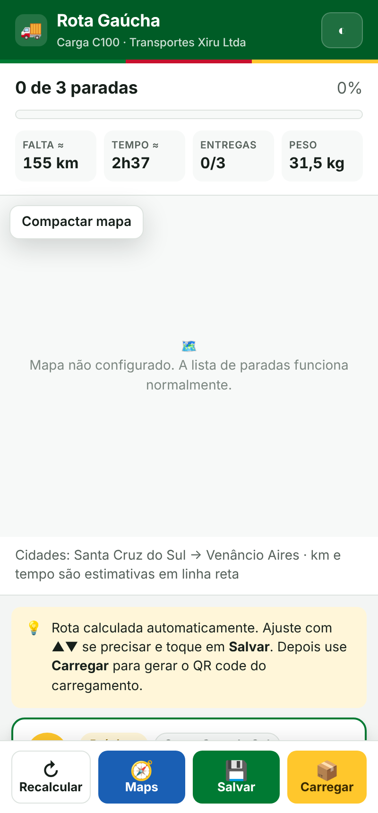
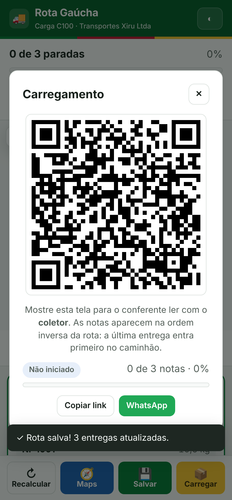
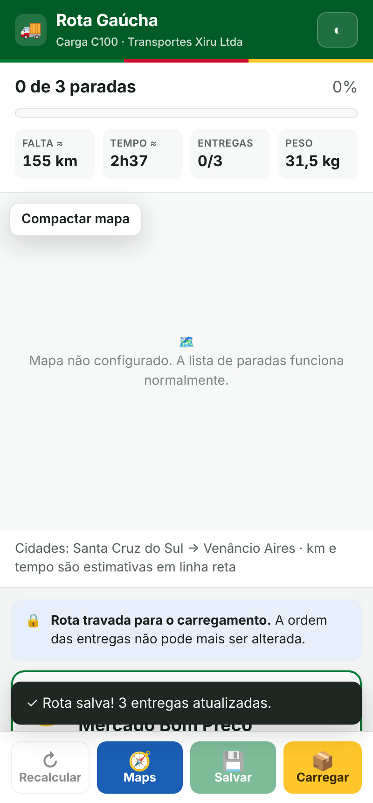
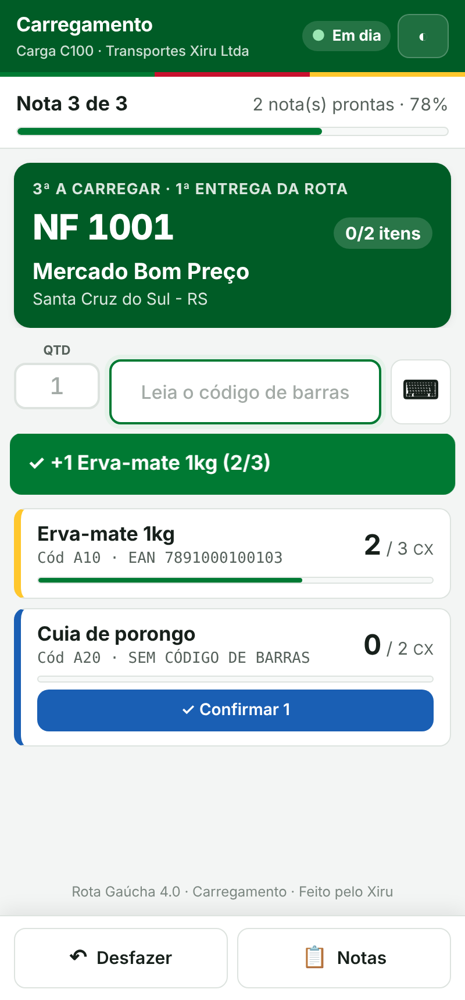
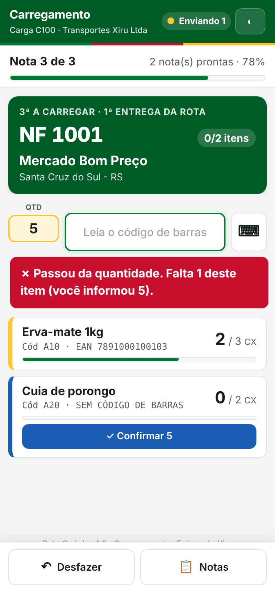
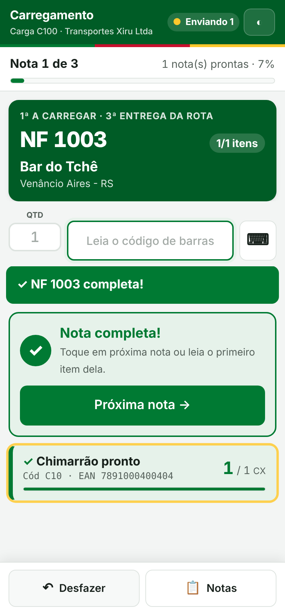
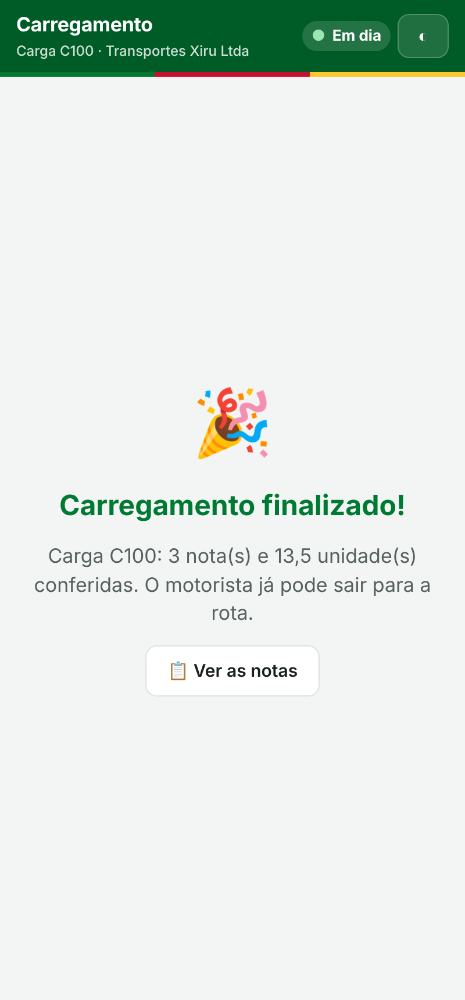
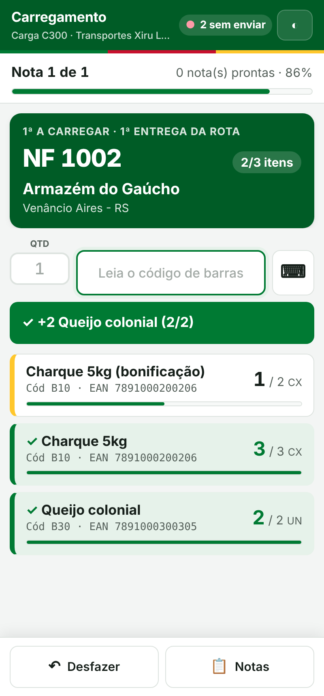
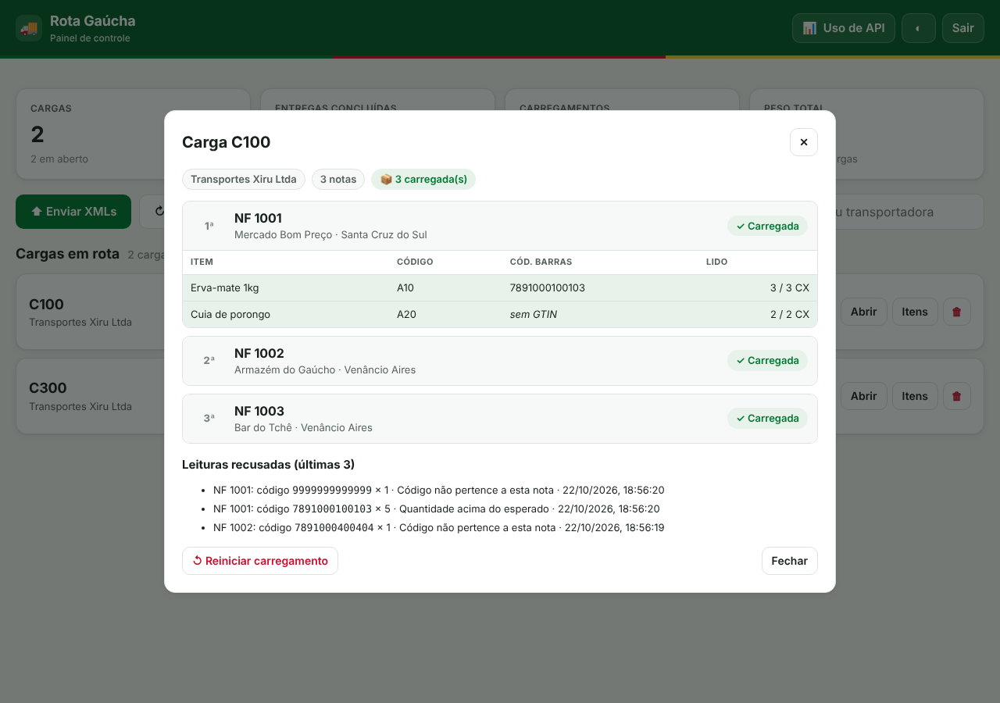

# Rota Gaúcha 4.0 · Roteirização e Carregamento

Sistema 100% web para distribuição: lê os XMLs de NF-e, monta a rota de entregas do motorista e confere o carregamento do caminhão item por item com um coletor de dados. Ninguém instala nada: o motorista usa o navegador do celular e o conferente só lê um QR code.

Evolução do [Ger_roteirizacao](https://github.com/Angeloxiru/Ger_roteirizacao) (versão 3.0), que continua funcionando separado. Todas as funções da 3.0 foram mantidas.

## Novidades da versão 4.0

- **Conferência de carregamento com coletor.** O motorista toca em **Carregar** e aparece um QR code. O conferente lê o QR com o coletor e confere cada nota: número da NF, cliente e a lista de itens. Cada leitura de código de barras soma no item, que fica verde quando completo.
- **Itens da nota salvos no banco**: código do item, descrição, código de barras (`cEANTrib`) e quantidade (`qTrib`).
- **Ordem inversa da rota**: a última entrega entra primeiro no caminhão.
- **Rota travada ao gerar o carregamento**: depois de tocar em **Carregar**, o motorista não consegue mais reordenar, recalcular nem salvar outra ordem. Só o escritório destrava, pelo painel.
- **Campo de quantidade** antes da leitura: vazio, cada leitura vale 1 unidade; com um número, a leitura vale aquele número. Só unidades inteiras.
- **Bloqueio por nota**: só passa para a próxima nota quando a atual estiver completa. Item sem código de barras é confirmado com um toque.
- **Avisos na hora**: código de outra nota (diz qual NF e cliente), quantidade acima do que falta, nota já completa. Som e vibração diferentes para acerto e erro.
- **Funciona com internet instável**: as leituras ficam guardadas no coletor e são enviadas quando a conexão volta.
- **Banco de dados de verdade (Turso)**, com tabelas, views e lookups. Excluir uma carga no painel apaga tudo dela no banco.
- **Painel** mostra o andamento do carregamento, os itens de cada nota, as leituras recusadas e permite reiniciar um carregamento.

## Telas

| Motorista | QR code | Rota travada | Coletor |
|:-:|:-:|:-:|:-:|
|  |  |  |  |

| Código errado | Nota completa | Finalizado | Sem internet |
|:-:|:-:|:-:|:-:|
|  |  |  |  |



## Funcionalidades

- **Importação de XML NF-e**: upload pelo painel (UTF-8 e ISO-8859-1) ou pasta `CargasCarregamento` no Drive (separada da pasta `CargasEmRota` da versão 3, para os dois sistemas rodarem na mesma conta sem interferir um no outro). Se a carga já existir, as NFs novas são acrescentadas sem perder o status das antigas.
- **Roteirização sem custo**: ordem das cidades e, dentro de cada cidade, ordem por proximidade (vizinho mais próximo + 2-opt + or-opt). Entregas no mesmo endereço viram uma parada só.
- **Tela do motorista**: próxima parada em destaque, **Entregue** com desfazer, reordenação com ▲▼, **Recalcular**, **Maps** com as próximas 4 paradas, aviso de "Cobrar à vista" e de "Local aproximado", e o botão **Carregar** com o QR code e o andamento da conferência (a partir daí a rota fica travada).
- **Tela do coletor**: notas na ordem inversa da rota, leitura por leitor de código de barras (o leitor "digita" o código e aperta Enter), teclado opcional para digitar, desfazer a última leitura, lista de notas, tela mantida acesa.
- **Painel administrativo**: cargas com progresso de entrega e de carregamento, rota salva ou travada, itens de cada nota, leituras recusadas, destravar rota, reiniciar carregamento, link do motorista (copiar, WhatsApp, abrir), envio de XMLs, sincronização com o Drive e exclusão.
- **Uso de API por transportadora**: carregamentos de mapa e geocodificações por CNPJ, com custo em reais (PTAX do Banco Central).
- **Auditoria**: acessos aos links (`log_acesso`), hora de cada entrega e cada leitura do carregamento, aceita ou recusada.

## Arquitetura

```
┌──────────────────────────── Google Apps Script ────────────────────────────┐
│ code.gs              Configuração, segurança, web app, menu, utilidades    │
│ Turso.gs             Acesso ao banco pela API HTTP do Turso                │
│ Schema.gs            SQL do banco (gerado de sql/schema.sql)               │
│ Cargas.gs            Gravar, ler e excluir cargas                          │
│ Painel.gs            Sincronizar Drive, upload, listar, detalhes, excluir  │
│ Motorista.gs         Buscar carga, entregas, ordem, QR do carregamento     │
│ Carregamento.gs      Abrir, registrar leituras, desfazer                   │
│ RegraCarregamento.gs Regra de conferência (roda no servidor e no coletor)  │
│ XMLProcessor.gs      Leitura das NF-e e dos itens                          │
│ Geo.gs               Geocodificação com cache + uso de API                 │
├─────────────────────────────────── Telas ──────────────────────────────────┤
│ PainelControle.html  ApiUsage.html  MotoristaView.html  CarregamentoView   │
└────────────────────────────────────────────────────────────────────────────┘
        │                        │                         │
   Turso (libSQL)           Google Drive          Maps do Apps Script
 todos os dados         XMLs (CargasCarregamento) geocodificação gratuita
```

Detalhes, decisões e o modelo de dados: [docs/ARQUITETURA.md](docs/ARQUITETURA.md).

## Estrutura de arquivos

Arquivos que vão para o Apps Script (o nome no editor fica sem a extensão `.html`):

| Arquivo | Descrição |
|---------|-----------|
| `code.gs` | Configuração, tokens dos links, senha do painel, `doGet`, menu da planilha |
| `Turso.gs` | Consultas e transações no banco |
| `Schema.gs` | Comandos SQL do banco. **Gerado**: não edite à mão |
| `Cargas.gs` | Importar notas e itens, excluir carga |
| `Painel.gs` | Funções do painel (todas exigem a senha) |
| `Motorista.gs` | Funções da tela do motorista (exigem o token do motorista) |
| `Carregamento.gs` | Funções da tela do coletor (exigem o token do carregamento) |
| `RegraCarregamento.gs` | Regra de conferência de cada leitura |
| `XMLProcessor.gs` | Leitura de XML NF-e (destinatário, endereço, peso, transportadora, pagamento, itens) |
| `Geo.gs` | Geocodificação com cache permanente e registro de uso de API |
| `PainelControle.html` | Painel administrativo |
| `ApiUsage.html` | Uso de API por transportadora |
| `MotoristaView.html` / `-css` / `-js` | Tela do motorista |
| `CarregamentoView.html` / `-css` / `-js` | Tela do coletor |
| `Roteirizacao-js.html` | Algoritmo de roteirização (roda no navegador) |
| `QRCode-js.html` | Gerador de QR code (qrcode-generator 1.4.4, licença MIT) |
| `Base-css.html` | Cores e componentes visuais comuns |
| `Comum-js.html` | Funções comuns das telas e login do painel |
| `Login-html.html` | Tela de login do painel |
| `appsscript.json` | Manifest do Apps Script |

Arquivos que ficam só no repositório:

| Pasta/arquivo | Descrição |
|---------------|-----------|
| `sql/schema.sql` | Fonte do schema: tabelas, índices, lookups e views |
| `tools/gerar-schema.js` | Gera o `Schema.gs` a partir do `schema.sql` |
| `testes/` | Testes automáticos (backend e telas) |
| `docs/` | Arquitetura e capturas de tela |

## Fluxo de uso

1. O escritório entra no painel e envia os XMLs da carga (ou coloca a pasta `C123` dentro de `CargasCarregamento` no Drive e clica em **Sincronizar**).
2. O sistema grava notas e itens no banco e geocodifica os endereços.
3. O escritório envia o link da carga ao motorista pelo WhatsApp.
4. O motorista confere a rota sugerida, ajusta se precisar e toca em **Salvar**.
5. O motorista toca em **Carregar**, confirma, e mostra o QR code ao conferente. A rota fica travada.
6. O conferente lê o QR com o coletor e confere nota por nota até aparecer **Carregamento finalizado**.
7. Na rua, o motorista toca em **Entregue** a cada parada.

## Instalação

### 1. Banco no Turso

1. Entre em [turso.tech](https://turso.tech) e crie um banco (por exemplo `rota-gaucha`), na região mais próxima do Brasil que estiver disponível.
2. Copie a **URL** do banco. Ela tem o formato `libsql://rota-gaucha-seuusuario.turso.io`.
3. Crie um **token** com permissão de leitura e escrita e copie.
4. Não precisa criar tabelas: o sistema cria tudo no passo 3 abaixo.

Pela linha de comando do Turso, o mesmo é: `turso db create rota-gaucha`, `turso db show rota-gaucha --url` e `turso db tokens create rota-gaucha`.

### 2. Apps Script

1. Crie uma planilha nova e, nela, abra *Extensões › Apps Script*. Use uma planilha diferente da versão 3, para as duas versões rodarem juntas.
2. Crie os arquivos da tabela "Arquivos que vão para o Apps Script" e cole o conteúdo de cada um. Em *Configurações do projeto*, marque "Mostrar o arquivo de manifesto appsscript.json" e cole o `appsscript.json`.
3. Implante como Web App (*Executar como: Eu*, *Quem pode acessar: Qualquer pessoa*).

### 3. Configuração

1. Recarregue a planilha e rode **🚚 Rota Gaúcha › Configurar sistema**: senha do painel, chave do Google Maps, URL e token do Turso. No fim ele cria as tabelas e mostra "Banco conectado".
2. Opcional: **🚚 Rota Gaúcha › Importar _GeoCache da versão 3** e cole o link da planilha da 3.0. Os endereços já conhecidos não precisam ser geocodificados de novo.
3. Use **🚚 Rota Gaúcha › Obter links de acesso** para abrir o painel.

### Coletor de dados

- Precisa de internet (Wi-Fi ou chip) e de um navegador (Chrome).
- O leitor deve estar no modo "teclado" (keyboard wedge), mandando **Enter** (ou Tab) depois do código. É o padrão da maioria dos coletores Android (Zebra, Honeywell, Urovo e similares).
- Para ler o QR code, use o próprio leitor do coletor ou a câmera.

## Atualizar a estrutura do banco

1. Altere `sql/schema.sql` (sempre com `IF NOT EXISTS`, e uma linha nova em `schema_versao`). Coluna nova em tabela que já existe vai no `CREATE TABLE` e também em `DB_COLUNAS_NOVAS`, no `Turso.gs`, que faz o `ALTER TABLE` nos bancos antigos.
2. Rode `npm run schema` para gerar o `Schema.gs`.
3. Cole o `Schema.gs` novo no Apps Script e rode **🚚 Rota Gaúcha › Testar e atualizar o banco**.

## Testes

Precisa de Node.js 22 ou mais novo (só para quem desenvolve; o sistema em si não precisa de instalação).

```
npm install
npm test             # backend: 26 testes com um Turso simulado em SQLite
npm run test:telas   # telas no Chromium, com capturas em testes/capturas/
```

## Ajustes finos

- **Ponto de partida**: o padrão é `Stock Center, BR 471, km 121 - Santa Cruz do Sul - RS`. Para trocar, crie a propriedade de script `ENDERECO_PARTIDA`.
- **Ponto errado no mapa**: corrija `lat` e `lng` na tabela `geo_cache` (pelo painel do Turso) e mude `precisao` para `manual`.
- **Estimativas de km e tempo**: em `Roteirizacao-js.html` (`FATOR_ESTRADA`, velocidades).
- **Custos da página de uso de API**: coluna `custo_por_mil` da tabela `lkp_tipo_api`.

## Propriedades do script

| Propriedade | Para que serve |
|-------------|----------------|
| `ADMIN_SENHA_HASH` | Hash da senha do painel (definida pelo menu) |
| `TOKEN_SEGREDO` | Segredo dos links do motorista e do coletor (gerado pelo menu) |
| `MAPS_API_KEY` | Chave do Google Maps para exibir o mapa |
| `TURSO_URL` | URL do banco (`libsql://...turso.io`) |
| `TURSO_TOKEN` | Token do banco |
| `ENDERECO_PARTIDA` | Opcional, troca o ponto de partida |

## Convenções do código

- Prefixos por módulo: `PAINEL_`, `MOTORISTA_`, `CARREG_`, `CARGA_`, `REGRA_`, `XML_`, `GEO_`, `API_`, `DB_`, `MENU_`.
- Funções terminadas em `_` são privadas: o navegador não consegue chamá-las.
- Toda função pública do painel recebe a senha como primeiro parâmetro; as do motorista e do coletor recebem o token do link.
- Datas no banco em texto ISO-8601 UTC.

## Licença

Projeto privado. Todos os direitos reservados. O `QRCode-js.html` é o qrcode-generator de Kazuhiko Arase, sob licença MIT.
